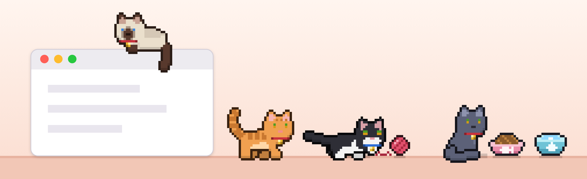
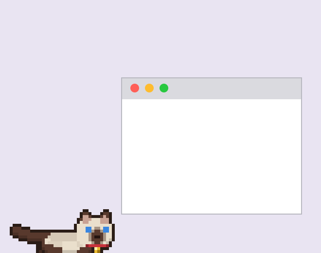
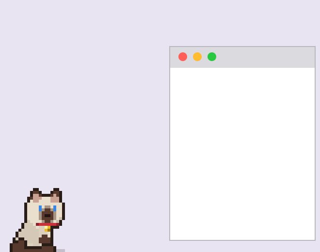
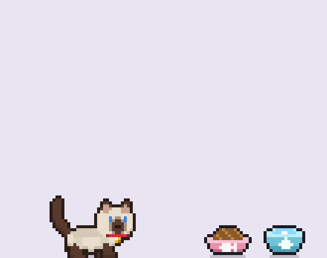

# Purrgram

Purrgram is a free app for Mac (and now Windows, in beta) that gives you a pixel-art pet cat that lives right on your desktop, alongside your windows while you work.

The cat has a mind of its own. It strolls along the bottom of your screen, hops up onto your open windows (and rides along when you drag them), naps, grooms, stretches, gets the zoomies, and squeezes underneath big windows to hide. Click it to pet it, drag it to pick it up, or toss it a ball of yarn and watch it play.

It also needs looking after, a bit like a Tamagotchi. Keep its food and water bowls full, give it attention, brush its coat and hand out the occasional treat, and it stays happy. Pick from 12 coats, add a collar, and choose its mood. Purrgram lives in your menu bar, lets your clicks pass straight through to your work, is light on battery, and runs entirely on your Mac without going online.



| | | |
|---|---|---|
|  |  |  |

## Download

Pick your computer:

| [](../../releases/latest/download/Purrgram.dmg) | [-0078D4?style=for-the-badge&logo=windows&logoColor=white)](../../releases/latest/download/Purrgram-Windows.zip) |
|:---:|:---:|
| **Mac** · full version<br>macOS 12 or newer, Apple Silicon and Intel<br>[Install steps](#install-on-mac) | **Windows (beta)** · Purrgram Lite<br>Windows 10 or 11<br>[Install steps](#install-on-windows-beta) |

All downloads are also on the [latest release](../../releases/latest) page.

## Install on Mac

1. Open `Purrgram.dmg` and drag **Purrgram** onto the **Applications** folder next to it. Then eject the disk image.
2. Open Purrgram from Applications. macOS will say Apple couldn't verify it, because it isn't from the App Store.
   Click **Done** (not "Move to Trash").
3. Go to **System Settings → Privacy & Security**, scroll down, click **Open Anyway** next to Purrgram, and confirm.
   (On macOS 14 or older you can instead right-click the app → **Open** → **Open**.)
4. Name your cat!

You only do steps 2–3 once.

### Check the download is genuine (optional)

Each release lists a SHA-256 fingerprint for the DMG. In Terminal:

```bash
shasum -a 256 ~/Downloads/Purrgram.dmg
```

The result should match the fingerprint on the release page exactly.

## Install on Windows (beta)

1. Download `Purrgram-Windows.zip`, right-click it → **Extract All**, and keep the `Purrgram` folder somewhere like Documents.
2. Double-click **Purrgram.exe**. Windows will say "Windows protected your PC", because the app isn't signed with a paid certificate.
   Click **More info**, then **Run anyway**. You only do this once.
3. Your cat appears on top of the taskbar, next to its bowls. Everything else is in the **cat icon in the system tray** (near the clock; it may be under the **^** arrow).

**Purrgram Lite** is the same cat, drawn from the exact same pixel art, with the basics: walking, sitting, loafing, napping, grooming, stretching, the zoomies, petting, picking up and tossing, the bowls (face in the bowl and all), needs and stats, 12 coats, moods, renaming, and Start with Windows. It stays on the floor (no window jumping yet), and has no yarn, mice, treats, brushing or sounds. It hides itself while a full-screen game, video or presentation is running. If people enjoy it, the rest is coming.

## Controls (Mac)

- **Click** the cat to pet it (they purr, but don't overdo it)
- **Double-click** to shoo it out of the way
- **Drag** to pick it up and drop it on a window
- **Click the bowls** (bottom-right corner) to fill food and water
- The **cat face in the menu bar** has stats, treats, yarn, mice, brushing, coats, collars, moods, Hide Everything (⌘H) and Settings (⌘,)

The cat's needs only change while your Mac is awake and Purrgram is running. Close the lid and everything pauses.

## Privacy

Purrgram runs entirely on your computer. It has no network code, so it never connects to the internet and sends nothing anywhere. It doesn't ask for any permissions. It reads where windows are on screen (not what's in them) so the cat can jump on them, and it only writes its own save file in `~/Library/Application Support/DesktopCat/`. On Windows it doesn't look at other windows at all, and saves to `%APPDATA%\Purrgram\`; turning on **Start with Windows** adds one entry under `HKEY_CURRENT_USER\…\Run`.

## Build from source

Requires the Xcode command line tools (`xcode-select --install`). Pure Swift with AppKit, no dependencies.

```bash
./build.sh
```

This compiles a universal app, runs a self-test, and writes `build/Purrgram.app`, `build/Purrgram.dmg` and `build/SHA256.txt`. A copy you build yourself opens without any security warning.

### Windows (beta)

Built on a Mac with the [.NET SDK](https://dotnet.microsoft.com/download) (`brew install dotnet`): the Mac renderer draws every animation frame, and a small C# app (WinForms, .NET Framework 4.8, which comes with Windows 10 and 11) plays them back.

```bash
windows/build.sh
```

This makes `windows/build/Purrgram-Windows.zip`.
